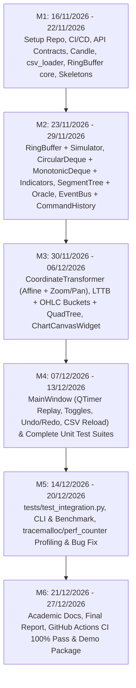

# Lộ trình Phát triển 6 Tuần — Interactive TradingView Stock Chart Engine (DSA Python)

- **Giai đoạn triển khai:** 16/11/2026 – 27/12/2026 (6 tuần / 6 Milestones: M1–M6)
- **Công nghệ cốt lõi:** Python 3.10+ (verified Python 3.14.9), `PyQt6>=6.6.0` (custom `QPainter` widget), `pytest>=8.0.0` (verified pytest 9.2.0)
- **Cấu trúc nhân sự:** 4 thành viên phân bổ đồng đều 25% – 25% – 25% – 25%

---

## Tổng quan Tiến độ (M1–M6)

---

## Chi tiết Từng Chặng Lộ trình & Tiêu chí Kiểm thử

### Tuần 1 — M1 (16/11/2026 – 22/11/2026 | Deadline: 22/11/2026)
- **Phạm vi kỹ thuật:**
  - Khởi tạo repository chuẩn hóa, cấu hình `requirements.txt` (`PyQt6>=6.6.0`, `pytest>=8.0.0`) và CI `.github/workflows/python-tests.yml`.
  - Khóa cứng 14 API Contracts trong `docs/interfaces.md`.
  - Cài đặt `Candle` frozen dataclass (`src/core/candle.py`) với kiểm định invariants tài chính.
  - Cài đặt `parse_candle_row` & `load_candles` (`src/core/csv_loader.py`) kiểm tra timestamp tăng nghiêm ngặt và báo lỗi theo dòng `line_num`.
  - Cài đặt khung lõi `RingBuffer` (`src/core/ring_buffer.py`, cấm `collections.deque`) và tạo skeleton chuẩn chữ ký cho `CircularDeque`, `SegmentTree`, `MainWindow`, `src/main.py`.
- **Tiêu chí kiểm thử (Verification Gate M1):**
  - `pip install -r requirements.txt` thành công.
  - `pytest -v` chạy thông suốt trên GitHub Actions CI cho các test khởi tạo `Candle`, `csv_loader` và `RingBuffer`.
  - Không có `collections.deque` trong `RingBuffer` hoặc `CircularDeque`.

### Tuần 2 — M2 (23/11/2026 – 29/11/2026 | Deadline: 29/11/2026)
- **Phạm vi kỹ thuật:**
  - Hoàn thiện `RingBuffer` + `generate_synthetic_candles` + `ReplayDataSource` (`src/core/data_simulator.py`) + bộ dữ liệu mẫu `data/sample_ohlcv.csv`.
  - Hoàn thiện `CircularDeque` (auto-resize 2x, cấm `collections.deque`), `MonotonicDeque` (`'min'` / `'max'`), và `SlidingWindowIndicators` (`rolling_min_max`, `sma`, `ema`, `donchian_channels`, `bollinger_bands`) tại `src/algorithms/monotonic_deque.py`.
  - Hoàn thiện `RangeStats`, `SegmentTree` (truy vấn nửa mở `[left, right)`, `update`, `append` với dynamic power-of-2 capacity rebuild) và oracle vét cạn `scan_range` tại `src/algorithms/segment_tree.py`.
  - Hoàn thiện `EventBus` (`src/patterns/observer.py`) và `Command` / `ViewportChangeCommand` / `CommandHistory` (`src/patterns/command_history.py`).
- **Tiêu chí kiểm thử (Verification Gate M2):**
  - Differential test: `SegmentTree.query(left, right)` phải khớp 100% với `scan_range(candles, left, right)` trên mọi dải chỉ số ngẫu nhiên.
  - `CircularDeque` ném `IndexError` khi rỗng và giữ đúng thứ tự FIFO/LIFO sau nhiều vòng mở rộng dung lượng $2\times$.
  - `MonotonicDeque` và `SlidingWindowIndicators` đạt độ chính xác số học $10^{-9}$ so với tính toán tham chiếu.
  - `CommandHistory` chứng minh Undo/Redo đúng trạng thái và cắt nhánh redo khi `execute()` lệnh mới.

### Tuần 3 — M3 (30/11/2026 – 06/12/2026 | Deadline: 06/12/2026)
- **Phạm vi kỹ thuật:**
  - Hoàn thiện `ViewportState` và `CoordinateTransformer` (`src/core/coordinate_math.py`) cho biến đổi Affine World $\leftrightarrow$ Screen, `zoom_at_pixel` neo theo con trỏ chuột và `pan_by_pixels`.
  - Hoàn thiện `LTTBDecimator.downsample` và `aggregate_ohlcv_buckets` (`src/algorithms/lttb_decimator.py`).
  - Hoàn thiện `Bounds`, `SpatialPoint`, `QuadTree` (`insert`, `query_range`, `nearest`) tại `src/algorithms/quad_tree.py`.
  - Xây dựng `ChartCanvasWidget` (`src/ui/chart_canvas.py`) dùng `QPainter` cùng phương thức headless `compute_visible_frame()`.
- **Tiêu chí kiểm thử (Verification Gate M3):**
  - Kiểm chứng biến đổi khả nghịch `screen_to_world(world_to_screen(i, p))` sai số $< 10^{-9}$ và bất biến điểm neo `x_to_index(pixel_x)` khi `zoom_at_pixel`.
  - `LTTBDecimator` bảo toàn điểm đầu/cuối; `aggregate_ohlcv_buckets` bảo toàn OHLCV chuẩn xác.
  - `QuadTree.query_range` & `QuadTree.nearest` khớp 100% với tìm kiếm tuyến tính vét cạn.
  - `ChartCanvasWidget.compute_visible_frame()` thực thi thành công ở chế độ headless không cần display server.

### Tuần 4 — M4 (07/12/2026 – 13/12/2026 | Deadline: 13/12/2026)
- **Phạm vi kỹ thuật:**
  - Hoàn thiện `MainWindow` (`src/ui/main_window.py`) tích hợp `ChartCanvasWidget`, `QTimer` Replay (Play/Pause/Reset/Speed), Indicator Toggles (SMA, EMA, Bollinger, Donchian, Decimation), Undo/Redo, CSV Reload và Status bar.
  - Hoàn thiện đầy đủ 4 bộ Unit Tests chuyên biệt: `tests/test_ring_buffer.py`, `tests/test_monotonic_deque.py`, `tests/test_segment_tree.py`, `tests/test_lttb.py`.
- **Tiêu chí kiểm thử (Verification Gate M4):**
  - `pytest -v` chạy toàn bộ 4 file unit test đạt 100% Pass.
  - Kiểm tra mọi trường hợp biên: dữ liệu ít hơn cửa sổ chỉ báo, CSV lỗi giữa file, thao tác Undo/Redo liên tiếp khi đang Replay.

### Tuần 5 — M5 (14/12/2026 – 20/12/2026 | Deadline: 20/12/2026)
- **Phạm vi kỹ thuật:**
  - Xây dựng `tests/test_integration.py` kiểm thử luồng End-to-End từ nạp dữ liệu $\to$ DSA pipeline $\to$ Command/Observer $\to$ `compute_visible_frame()`.
  - Hoàn thiện CLI & Benchmark runner trong `src/main.py` theo chuẩn:
    - `python3 -m src.main [--cli | --benchmark | --gui] [--csv data/sample_ohlcv.csv] [--count 10000]`
  - Thực hiện profiling bộ nhớ (`tracemalloc`) và thời gian thực thi (`time.perf_counter`), xử lý các lỗi biên & tối ưu hiệu năng.
- **Tiêu chí kiểm thử (Verification Gate M5):**
  - `python3 -m src.main --cli` và `python3 -m src.main --benchmark` chạy thành công và xuất số liệu hiệu năng rõ ràng.
  - `pytest -v` (bao gồm cả `tests/test_integration.py`) đạt 100% Pass.
  - Kiểm chứng độ phức tạp thực nghiệm $O(\log N)$ của `SegmentTree.query` vượt trội rõ rệt so với $O(N)$ của `scan_range` ở `--count 10000`+.

### Tuần 6 — M6 (21/12/2026 – 27/12/2026 | Deadline: 27/12/2026)
- **Phạm vi kỹ thuật:**
  - Hoàn thiện toàn bộ tài liệu học thuật & hướng dẫn kỹ thuật (`README.md`, `ROADMAP.md`, `DEADLINES_AND_TASKS.md`, `CONTRIBUTING.md`, `docs/interfaces.md`, `docs/team_plan_report.md`).
  - Tổng rà soát code quality, docstrings, type hints, loại bỏ code thừa.
  - Xác minh CI GitHub Actions xanh 100% trên nhánh `main`, đóng gói sản phẩm và chuẩn bị Demo cuối kỳ.
- **Tiêu chí kiểm thử (Verification Gate M6):**
  - 100% lệnh chuẩn hoạt động ổn định:
    - `pip install -r requirements.txt`
    - `pytest -v`
    - `python3 -m src.main --cli`
    - `python3 -m src.main --benchmark`
    - `python3 -m src.main`
  - GitHub Actions CI pass 100% trên commit bàn giao cuối cùng ngày 27/12/2026.
