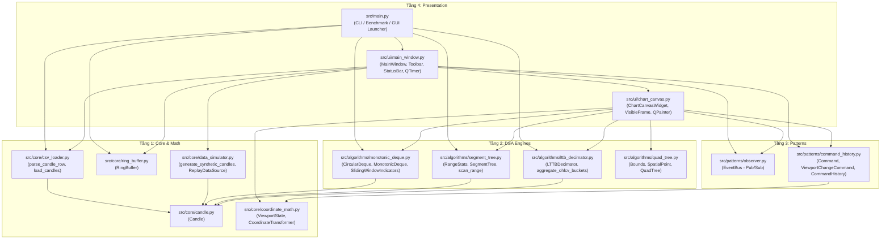
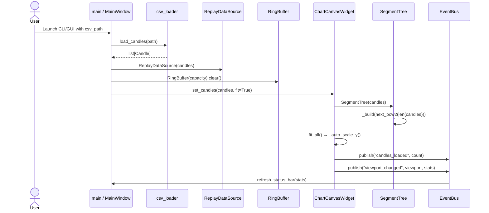
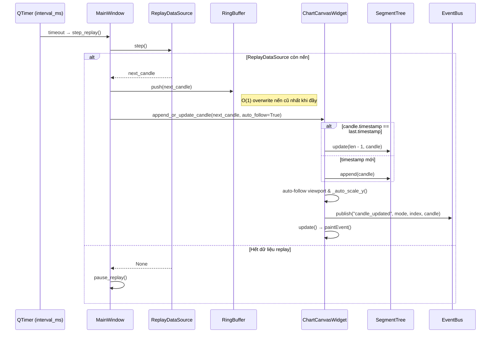
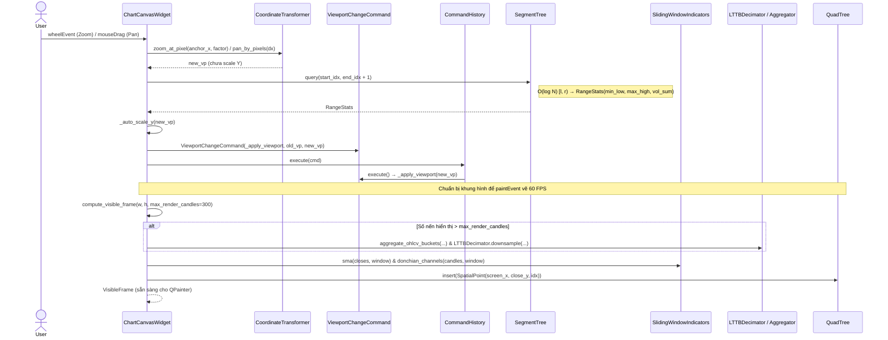
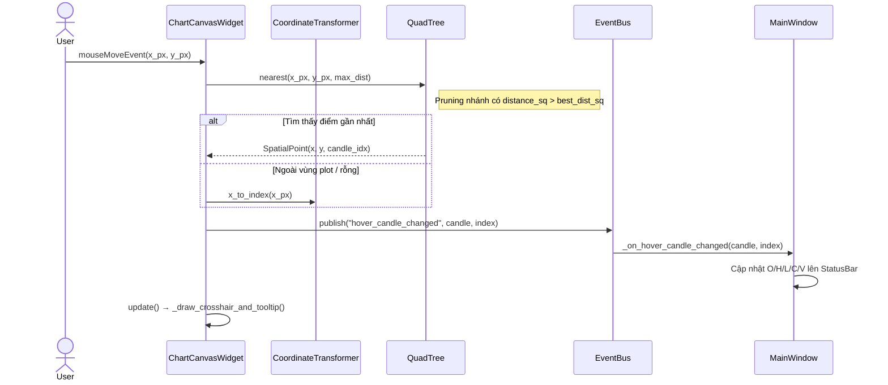
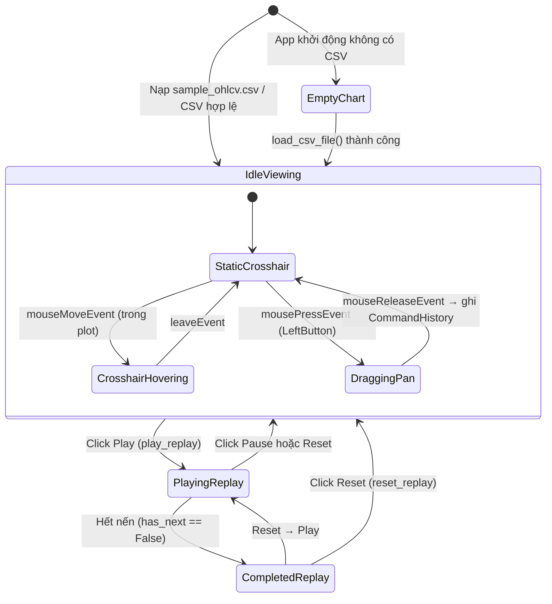

# Kiến Trúc Phần Mềm & Sơ Đồ UML (Software Architecture & UML Diagrams)

Tài liệu này mô tả chi tiết **kiến trúc phần mềm 4 tầng (Layered Architecture)** và bộ **sơ đồ UML chuẩn (Mermaid)** cho dự án **TradingView Mini (OHLCV Chart Engine)** bằng Python & PyQt6. Nhóm 4 sinh viên dùng tài liệu này để đối chiếu ranh giới giữa các module trước khi tự implement từng hàm/phương thức trong `src/`.

> [!NOTE]
> Toàn bộ source code trong `src/` được thiết kế theo dạng **Skeleton + Step-by-Step Guide** (chỉ giữ chữ ký hàm/phương thức và docstring hướng dẫn thuật toán, thân hàm để `pass`) để từng thành viên tự lập trình phần DSA và UI của mình mà không xung đột interface.
> Nếu bạn đang mở file `.md` này trong Antigravity IDE / VS Code mà chưa cài extension preview Mermaid (ví dụ *Markdown Preview Mermaid Support*), có thể mở trực tiếp trên GitHub, PyCharm (Mermaid plugin), [mermaid.live](https://mermaid.live), hoặc chạy preview HTML cục bộ.

---

## 1. Sơ Đồ Kiến Trúc Phân Tầng & Phụ Thuộc Package (Component / Package Diagram)

### Quy tắc phụ thuộc (Dependency Inversion / Strict Layering)
1. **Không import ngược chiều**: Các module DSA (`core/ring_buffer.py`, `algorithms/*`) **tuyệt đối không** import `PyQt6`, `ui/*`, hay `patterns/*`. Điều này giúp test DSA độc lập hoàn toàn qua `pytest` mà không cần GUI.
2. **Giao tiếp qua `EventBus` & `ViewportState`**: `ChartCanvasWidget` không giữ tham chiếu trực tiếp tới `MainWindow`; mọi cập nhật `range_stats`, `viewport`, `hover_candle` đi qua `EventBus`.
3. **Bất biến (Invariant) `collections.deque`**: Member 1 (`RingBuffer`) và Member 2 (`CircularDeque`, `MonotonicDeque`) bị kiểm tra AST tự động cấm import `collections.deque`.

---

## 2. Sơ Đồ Lớp Tổng Thể (UML Class Diagram)

> [!TIP]
> Quy ước ký hiệu UML trong sơ đồ bên dưới để tương thích mọi trình render Mermaid:
> - Constructor UML `ClassName(...)` tương ứng `__init__(self, ...)` trong Python; các phương thức đặc biệt `post_init()`, `len()`, `iter()`, `getitem()` tương ứng `__post_init__`, `__len__`, `__iter__`, `__getitem__`.
> - Bí danh kiểu: `Point2D = tuple[float, float]`, `DonchianBand = tuple[float, float, float]`, `IntPair = tuple[int, int]`, `StrIntPair = tuple[str, int]`, `Optional~X~ = X | None`.

```mermaid
classDiagram
    direction TB

    class Candle {
        <<dataclass>>
        +int timestamp
        +float open
        +float high
        +float low
        +float close
        +float volume
        +post_init() None
        +is_bullish() bool
        +body_low() float
        +body_high() float
    }

    class RingBuffer~T~ {
        -int _capacity
        -list~T~ _buffer
        -int _head
        -int _tail
        -int _size
        +RingBuffer(capacity: int) None
        +capacity() int
        +push(item: T) None
        +get_all() list~T~
        +latest() Optional~T~
        +oldest() Optional~T~
        +is_full() bool
        +is_empty() bool
        +clear() None
        +len() int
        +iter() Iterator~T~
        +getitem(index: IntOrSlice) Any
    }

    class ReplayDataSource {
        +ReplayDataSource(candles: Sequence~Candle~) None
        +has_next() bool
        +step() Optional~Candle~
        +reset() None
        +progress() IntPair
        +candles() list~Candle~
        +replace_or_append(candle: Candle) StrIntPair
    }

    class ViewportState {
        <<dataclass>>
        +float start_idx
        +float end_idx
        +float min_price
        +float max_price
        +int width_px
        +int height_px
        +int padding_left
        +int padding_right
        +int padding_top
        +int padding_bottom
        +plot_left() float
        +plot_right() float
        +plot_top() float
        +plot_bottom() float
        +plot_width() float
        +plot_height() float
    }

    class CoordinateTransformer {
        +CoordinateTransformer(viewport: ViewportState) None
        +viewport() ViewportState
        +index_to_x(index: float) float
        +x_to_index(x_px: float) float
        +price_to_y(price: float) float
        +y_to_price(y_px: float) float
        +world_to_screen(index: float, price: float) Point2D
        +screen_to_world(x_px: float, y_px: float) Point2D
        +zoom_at_pixel(anchor_x: float, zoom_factor: float, min_span: float, max_span: float) ViewportState
        +pan_by_pixels(dx_px: float) ViewportState
    }

    class CircularDeque~T~ {
        +CircularDeque(capacity: int) None
        -_resize(new_capacity: int) None
        +push_front(x: T) None
        +push_back(x: T) None
        +pop_front() T
        +pop_back() T
        +peek_front() T
        +peek_back() T
        +clear() None
        +to_list() list~T~
        +len() int
        +is_empty() bool
    }

    class MonotonicDeque {
        +MonotonicDeque(mode: str) None
        +push(index: int, value: float) None
        +evict_before(min_valid_index: int) None
        +extrema() Optional~IndexValPair~
        +clear() None
        +len() int
    }

    class SlidingWindowIndicators {
        <<utility>>
        +rolling_min_max(values: Sequence~float~, window: int)$ list~Point2D~
        +sma(values: Sequence~float~, window: int)$ list~OptionalFloat~
        +ema(values: Sequence~float~, window: int)$ list~OptionalFloat~
        +donchian_channels(candles: Sequence~Candle~, window: int)$ list~DonchianBand~
        +bollinger_bands(values: Sequence~float~, window: int, num_std: float)$ list~BollingerBand~
    }

    class RangeStats {
        <<dataclass>>
        +float min_low
        +float max_high
        +float volume_sum
    }

    class SegmentTree {
        +SegmentTree(candles: Optional~SequenceCandle~) None
        -_build(capacity: int) None
        -_set_leaf(index: int, candle: Candle) None
        +query(left: int, right: int) Optional~RangeStats~
        +update(index: int, candle: Candle) None
        +append(candle: Candle) None
        +get_candle(index: int) Candle
        +len() int
    }

    class LTTBDecimator {
        <<utility>>
        +downsample(points: Sequence~Point2D~, threshold: int)$ list~Point2D~
    }

    class Bounds {
        <<dataclass>>
        +float x_min
        +float y_min
        +float x_max
        +float y_max
        +contains(x: float, y: float) bool
        +intersects(other: Bounds) bool
        +distance_sq_to_point(x: float, y: float) float
    }

    class SpatialPoint~T~ {
        <<dataclass>>
        +float x
        +float y
        +T payload
    }

    class QuadTree~T~ {
        +QuadTree(bounds: Bounds, capacity: int, max_depth: int) None
        -_subdivide(node: QuadNode) None
        -_select_child(node: QuadNode, x: float, y: float)$ QuadNode
        -_insert_into(node: QuadNode, point: SpatialPoint~T~) None
        +insert(point: SpatialPoint~T~) bool
        +query_range(rect: Bounds) list~SpatialPoint~
        +nearest(x: float, y: float, max_dist: float) Optional~SpatialPoint~
        +len() int
    }

    class EventBus {
        +EventBus() None
        +subscribe(event_name: str, callback: Callable) Callable
        +unsubscribe(event_name: str, callback: Callable) bool
        +publish(event_name: str, args: Any, kwargs: Any) int
        +clear(event_name: Optional~str~) None
        +listener_count(event_name: Optional~str~) int
    }

    class Command {
        <<abstract>>
        +description() str
        +execute() None
        +undo() None
    }

    class ViewportChangeCommand {
        +ViewportChangeCommand(apply_fn: Callable, old_viewport: ViewportState, new_viewport: ViewportState, description: str) None
        +execute() None
        +undo() None
    }

    class CommandHistory {
        +CommandHistory(max_size: int) None
        +max_size() int
        +execute(cmd: Command) None
        +undo() Optional~Command~
        +redo() Optional~Command~
        +can_undo() bool
        +can_redo() bool
        +clear() None
        +len() int
    }

    class VisibleFrame {
        <<dataclass>>
        +ViewportState viewport
        +Optional~RangeStats~ range_stats
        +list~Candle~ render_candles
        +list~float~ candle_indices
        +list~Point2D~ sma_points
        +list~Point2D~ donchian_upper
        +list~Point2D~ donchian_middle
        +list~Point2D~ donchian_lower
        +list~Point2D~ decimated_close_points
        +int total_candles
        +int start_idx
        +int end_idx
    }

    class ChartCanvasWidget {
        +ChartCanvasWidget(event_bus, command_history, sma_window, donchian_window, parent) None
        +set_candles(candles: Sequence~Candle~, fit: bool) None
        +append_or_update_candle(candle: Candle, auto_follow: bool) str
        +set_viewport(viewport: ViewportState, record_history: bool, description: str) None
        +fit_all(record_history: bool) None
        +set_overlays(sma, donchian, volume) None
        +get_visible_range_stats() Optional~RangeStats~
        +compute_visible_frame(width_px, height_px, max_render_candles) VisibleFrame
        +paintEvent(event: QPaintEvent) None
    }

    class MainWindow {
        +MainWindow(csv_path, ring_capacity, sma_window, donchian_window, parent) None
        -_apply_dark_stylesheet() None
        -_build_toolbar() None
        -_build_status_bar() None
        -_bind_events() None
        -_sync_history_actions() None
        +play_replay() None
        +pause_replay() None
        +step_replay() Optional~Candle~
        +reset_replay() None
        +set_replay_speed(multiplier: float) None
        +load_csv_file(path: StrOrPath) list~Candle~
    }

    ReplayDataSource o-- Candle
    RingBuffer o-- Candle
    SegmentTree ..> Candle
    SegmentTree ..> RangeStats
    MonotonicDeque *-- CircularDeque
    SlidingWindowIndicators ..> MonotonicDeque
    QuadTree *-- Bounds
    QuadTree o-- SpatialPoint
    CoordinateTransformer *-- ViewportState
    ViewportChangeCommand --|> Command
    ViewportChangeCommand *-- ViewportState
    CommandHistory o-- Command
    ChartCanvasWidget *-- SegmentTree
    ChartCanvasWidget *-- EventBus
    ChartCanvasWidget *-- CommandHistory
    ChartCanvasWidget *-- ViewportState
    ChartCanvasWidget ..> CoordinateTransformer
    ChartCanvasWidget ..> SlidingWindowIndicators
    ChartCanvasWidget ..> LTTBDecimator
    ChartCanvasWidget *-- QuadTree
    ChartCanvasWidget ..> VisibleFrame
    MainWindow *-- ChartCanvasWidget
    MainWindow *-- ReplayDataSource
    MainWindow *-- RingBuffer
    MainWindow *-- EventBus
    MainWindow *-- CommandHistory
```

---

## 3. Các Sơ Đồ Tuần Tự (UML Sequence Diagrams)

### 3.1. Luồng Khởi Tạo & Nạp Dữ Liệu CSV (`load_csv_file` -> `ChartCanvasWidget.set_candles`)

### 3.2. Luồng Replay Realtime (`QTimer` -> `RingBuffer` -> `SegmentTree` -> Vẽ Lại)

### 3.3. Luồng Pan/Zoom Tương Tác, Undo/Redo & Render Khung Hình (`compute_visible_frame`)

### 3.4. Luồng Crosshair Hover & `QuadTree` Nearest-Point Snap

---

## 4. Sơ Đồ Trạng Thái Tương Tác UI & Replay (UML State Machine Diagram)

---

## 5. Ma Trận Phân Công Code Theo Lớp & Module (Member Responsibility Matrix)

| Thành viên | Tỷ trọng | Module phụ trách | Các Class / Function cốt lõi cần tự implement | Mục tiêu kiểm thử |
| :--- | :---: | :--- | :--- | :--- |
| **Thành viên 1** | 25% | `src/core/candle.py`, `src/core/csv_loader.py`, `src/core/ring_buffer.py`, `src/core/data_simulator.py` | `Candle`, `parse_candle_row`, `load_candles`, `RingBuffer`, `generate_synthetic_candles`, `ReplayDataSource` | [test_ring_buffer.py](file:///home/waxurlkioeln/Documents/dsa_proj/tests/test_ring_buffer.py) |
| **Thành viên 2** | 25% | `src/algorithms/monotonic_deque.py`, `src/core/coordinate_math.py` | `CircularDeque`, `MonotonicDeque`, `_SlidingWelfordQueue`, `SlidingWindowIndicators`, `ViewportState`, `CoordinateTransformer` | [test_monotonic_deque.py](file:///home/waxurlkioeln/Documents/dsa_proj/tests/test_monotonic_deque.py) |
| **Thành viên 3** | 25% | `src/algorithms/segment_tree.py`, `src/algorithms/lttb_decimator.py`, `src/algorithms/quad_tree.py` | `RangeStats`, `scan_range`, `SegmentTree`, `LTTBDecimator`, `aggregate_ohlcv_buckets`, `Bounds`, `SpatialPoint`, `QuadTree` | [test_segment_tree.py](file:///home/waxurlkioeln/Documents/dsa_proj/tests/test_segment_tree.py), [test_lttb.py](file:///home/waxurlkioeln/Documents/dsa_proj/tests/test_lttb.py) |
| **Thành viên 4 (Trưởng nhóm)** | 25% | `src/patterns/observer.py`, `src/patterns/command_history.py`, `src/ui/chart_canvas.py`, `src/ui/main_window.py`, `src/main.py` | `EventBus`, `Command`, `ViewportChangeCommand`, `CommandHistory`, `VisibleFrame`, `ChartCanvasWidget`, `MainWindow`, `run_cli`, `run_benchmark`, `run_gui`, `main` | [test_integration.py](file:///home/waxurlkioeln/Documents/dsa_proj/tests/test_integration.py) |

---

## 6. Giao Ước Sự Kiện `EventBus` (Event Contracts)

Để Member 4 kết nối `ChartCanvasWidget` và `MainWindow` sạch sẽ theo mẫu Observer:

| Tên Event | Payload (`*args`) | Publisher | Subscriber |
| :--- | :--- | :--- | :--- |
| `"candles_loaded"` | `(count: int)` | `ChartCanvasWidget.set_candles` | `MainWindow` (tùy chọn) |
| `"candle_updated"` | `(mode: str, index: int, candle: Candle)` | `ChartCanvasWidget.append_or_update_candle` | `MainWindow` (tùy chọn) |
| `"viewport_changed"` | `(viewport: ViewportState, stats: RangeStats \| None)` | `ChartCanvasWidget._apply_viewport` | `MainWindow._refresh_status_bar` & `_sync_history_actions` |
| `"hover_candle_changed"` | `(candle: Candle \| None, index: float \| None)` | `ChartCanvasWidget.mouseMoveEvent` / `leaveEvent` | `MainWindow._on_hover_candle_changed` |
| `"history_changed"` | `()` hoặc `(can_undo: bool, can_redo: bool)` | `CommandHistory` / `ChartCanvasWidget` | `MainWindow._sync_history_actions` |
